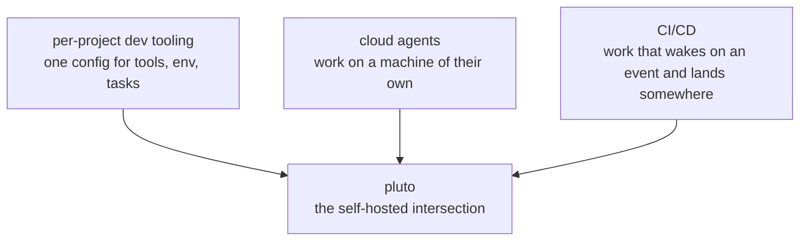
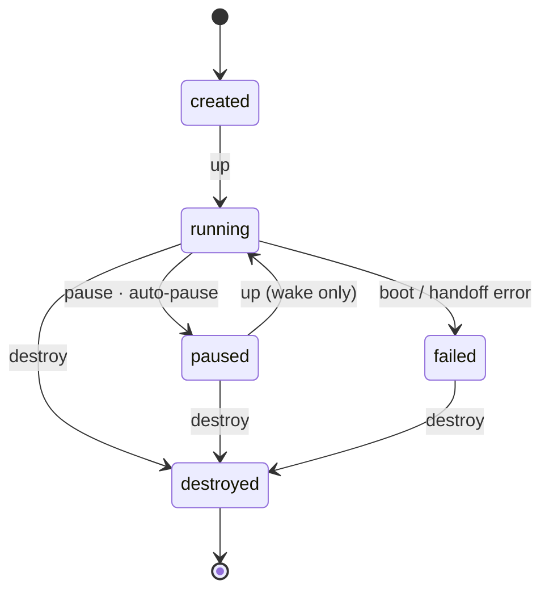
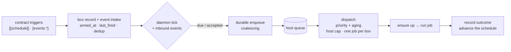
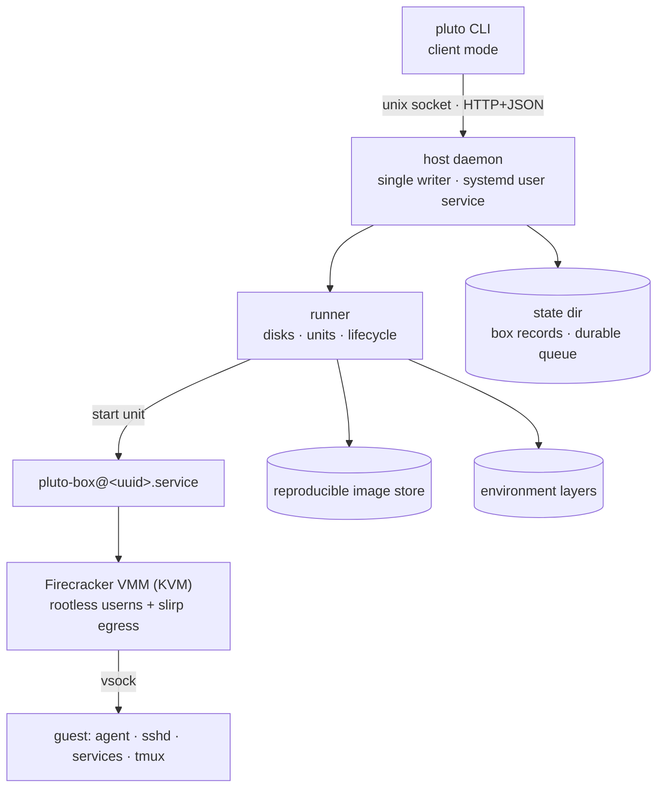

# pluto — durable work machines

*A research pitch for the whole system: durable, stateful, per-branch offload with
lifecycle-aware scheduling and event-driven work, on hardware you own.*

---

## Thesis

Long-running work — coding agents, builds, tests, migrations — is tied to a
developer's laptop and dies when it sleeps. The existing ways to move that work
off the laptop are **ephemeral** (serverless), **shared** (clusters and CI), or
**not yours** (hosted cloud dev environments). pluto gives every unit of version
control its own **durable work machine**: a microVM box that provisions once,
wakes for work, sleeps when idle, is scheduled into, and can be entered over SSH.

> The contribution is the **coupling**: a scheduler whose target is a durable,
> stateful, per-branch machine with a wake/sleep lifecycle — not a new VMM and not
> a new scheduling policy.

---

## 1. Motivation

Developers increasingly run **long, automated, stateful** work: an agent edits a
branch for an hour, a test suite runs for twenty minutes, a nightly migration
touches a database. That work is attached to a laptop, which is the wrong place
for it — the laptop sleeps, closes, or reboots, and the work stops.

Four families of existing infrastructure each solve part of this, and each leaves
the same hole:

- **Hosted cloud sandboxes and dev environments** move the work off the laptop,
  but they own your machine and your account, and their environments are
  ephemeral or container-based.
- **CI/CD runners** wake on events and land work somewhere inspectable, but the
  runner is disposable and the environment is not yours to return to.
- **Serverless** gives compute that scales to zero and wakes on demand, but the
  unit is stateless and short-lived, and it is not a machine you can enter.
- **Cluster schedulers** (Borg and descendants) schedule jobs across machines
  brilliantly, but they treat the execution target as an interchangeable slot in
  a shared pool.

pluto's premise is that the missing abstraction is a **durable, personal machine
owned by a branch**, and that a scheduler should drive *that machine's lifecycle*
rather than allocate slots.

pluto sits at the intersection of three ideas:



## 2. Related work

Four papers anchor the positioning; two more are the substrate and the durable
queue.

| Work | What we borrow | What it assumes that we break |
|---|---|---|
| **Borg** — Verma et al. [1] | Priority classes, aging, admission, capacity caps | Targets are interchangeable slots in a shared cluster |
| **Serverless survey** — Li et al. [2] | Scale-to-zero, wake-on-demand, offload to managed compute | Compute is ephemeral and stateless; not enterable; state is externalized |
| **Task-scheduling survey** — Arunarani et al. [3] | The scheduling taxonomy: queues, fairness, starvation | Scheduling is cluster-centric; the resource is a slot, not a sleeping machine |
| **Container security survey** — Sultan et al. [4] | The isolation boundary is a first-class concern | Argues containers are weak; does not supply a stronger, usable boundary |

The microVM substrate (**Firecracker**) and the durable-queue lineage
(**Condor**) are named as systems, not cited. The offload-for-latency,
live-migration, and container-overhead literatures are out of scope for this
pitch.

## 3. The gap

Each ingredient exists; the composition does not. Precisely:

1. **Schedulers** treat the execution target as an interchangeable slot. pluto's
   target is a **specific machine owned by a branch**, with state that persists.
2. **Serverless** gives scale-to-zero offload, but the unit is **ephemeral and
   stateless** and cannot be entered. pluto keeps the machine **durable and
   stateful**.
3. **Isolation** work motivates a boundary; pluto **realizes** it with a microVM
   at acceptable overhead.
4. **Durable queues** let work outlive the submitter; pluto binds them to a
   **machine lifecycle** and to **repository events**.

Nobody asks: *what if the scheduling target is a machine that sleeps, belongs to a
branch, and must be woken before it can run the job?*

## 4. Contributions

- **C1 — Durable, stateful offload target.** Work is offloaded to a machine whose
  disk persists across sleep, inverting serverless's statelessness. The target
  survives the laptop, a daemon restart, and a host reboot.
- **C2 — Lifecycle-aware scheduling.** The scheduler's resource is a machine with
  **states** (paused/running) and a **boot cost**. Scheduling therefore includes
  *waking the target*; pause is an idle policy. Borg does not model this.
- **C3 — Durable, crash-safe triggers.** Schedules and repository events are
  materialized into a durable host queue *before time advances*, with priority
  classes, aging, coalescing, and at-least-once delivery. Time-triggered and
  event-triggered work become the same durable object.
- **C4 — Agent-agnostic durable sessions.** Long-lived interactive processes
  (agents, TUIs) are declared in the repo, owned by tmux, survive a wake from
  their own on-disk state, and are attachable — without any agent-specific API.

The **substrate** that realizes these — rootless Firecracker microVMs over vsock,
a repo-declared contract, reproducible images, reusable environment layers, and
SSH/device access — is engineering we adopt, not a research claim.

## 5. System design

### 5.1 The box and the contract

A box belongs to one **worktree** (a checkout on one branch, by path) and is
declared by a committed `.pluto.toml`. The contract separates expensive,
once-per-box work from cheap per-wake repair and declares everything the box can
do:

```toml
[box]
resources = { cpus = 4, memory = "8GiB", disk = "40GiB" }
auto_pause = "1h"

[tools]
packages = ["build-essential", "curl"]

[provision]          # once per box, on the durable disk
command = ".pluto/provision.sh"

[wake]               # every start, short and idempotent
command = ".pluto/wake.sh"

[jobs.test]          # bounded, recorded work
command = "pnpm test"

[services.dev]       # long-lived, supervised, restarted on wake
command = "pnpm dev"
port = 3000

[sessions.agent]     # long-lived, attachable, tmux-owned
command = "opencode"

[[schedule]]         # a durable time trigger
name = "nightly"
cron = "0 2 * * *"
job = "test"
```

The contract is versioned with the code, hashed when applied, and applied on the
next boot — so a box records exactly what it is running.

### 5.2 Lifecycle

`pause` is the only dormant state; the disk stays on the host and `up` wakes it.
Durability is deliberately modest: disk state is as of the last graceful stop,
and **git is the floor**.



Auto-pause is one rule: no client attached **and** no job running for the idle
window. Wake runs on every start; provision runs once per disk.

### 5.3 Scheduling and triggers

A trigger is a durable activation: *ensure running → optionally run a job →
record the outcome*. Schedules live on the box record; a due occurrence is
enqueued into a durable host queue before the clock advances, so a crash cannot
lose or double-fire it.



Repository events extend the same queue: pushes, pull requests, issues, and
generic webhooks are admitted by a **trusted default-branch policy** and
materialized as durable work. A PR or issue becomes a **work item** — a reusable
box keyed by repository, kind, and number — and **trust classes** scope what
untrusted code may see and publish.

### 5.4 Sessions

A **session** is a durable, attachable interactive process owned by tmux. It dies
on pause; wake restarts it, and the program's own on-disk state resumes it. This
is what makes "an agent runs in the box and I attach to the machine" real without
any agent-specific integration.

### 5.5 Substrate



- **Isolation**: a microVM boundary, run rootless (user + network namespace),
  sized by cgroup caps. The jailer is deliberately absent while single-user.
- **Images**: pinned and reproducible (kernel, rootfs, Firecracker by hash); a box
  pins the image version it first booted with.
- **Environment layers**: an opt-in, content-addressed snapshot of a provisioned
  disk, trust-scoped, so later boxes clone a ready layer instead of provisioning.
- **Access**: SSH over vsock; the CLI is the control surface. A second machine
  reaches the host with `pluto --device <nickname>`.

## 6. Evaluation

The system is measured by its own loop, on a real host (`scripts/e2e-m1.sh`,
`e2e-m2.sh`): time to first shell, pause/wake latency, provision duration, and
whether a schedule fires, an agent works, the machine sleeps, and the work lands
somewhere inspectable. The demo that proves the claim: **create a box, run a build
in it, show the machine exists and persists across a pause.**

## 7. Limitations and non-claims

Single host; delivery is at-least-once (a crash window can duplicate a run);
durability is last-clean-stop and git is the recovery path; no memory snapshots;
no cross-host handoff; **no isolation or security guarantee is claimed** (the
jailer is absent by design); no hosted service, accounts, control plane, or
telemetry; no content-addressed deduplication.

## 8. Roadmap

| Milestone | What it adds |
|---|---|
| **M0** | The walking skeleton: up, provision, run, attach, pause, wake, auto-pause, destroy |
| **M1** | Wake for work: schedules, job history, saved devices and remote control |
| **M2** | Agent sessions: durable tmux-owned sessions that survive a pause |
| **M3** | Platform refresh: reproducible hash-locked image, real resources, pins |
| **M4** | Events: push/PR/issue/webhooks and git hooks, work items, trust classes |
| **M5** | Coherence: a polished CLI pass — grammar, taxonomy, output, review surface |

---

## Appendix — the vocabulary

`box` (a durable machine owned by a worktree) · `worktree` (a checkout on one
branch) · `box contract` (`.pluto.toml`) · `provision` (once per disk) · `wake`
(every start) · `service` (supervised, restarted on wake) · `session` (durable,
attachable, tmux) · `trigger` / `schedule` / `event` (durable activation) ·
`job` (bounded recorded work) · `up` / `run` / `attach` / `pause` / `destroy` ·
`device` (a saved ssh destination) · `runner` / `VMM` / `guest agent`.

Full definitions: `GLOSSARY.md`. Decisions: `docs/adr/`. Deferred work:
`docs/DEFERRED.md`.

---

## References

1. Verma, A., Pedrosa, L., Korupolu, M., Oppenheimer, D., Tune, E., Wilkes, J.
   **Large-scale cluster management at Google with Borg.** *EuroSys '15*, 1–17.
   <https://doi.org/10.1145/2741948.2741964>
2. Li, Z., Guo, L., Cheng, J., Chen, Q., He, B., Guo, M. **The Serverless
   Computing Survey: A Technical Primer for Design Architecture.** *ACM
   Computing Surveys*, 54(10s):1–34, 2022. <https://doi.org/10.1145/3508360>
3. Arunarani, A. R., Manjula, D., Sugumaran, V. **Task scheduling techniques in
   cloud computing: A literature survey.** *Future Generation Computer Systems*,
   91:407–415, 2019. <https://doi.org/10.1016/j.future.2018.09.014>
4. Sultan, S., Ahmad, I., Dimitriou, T. **Container Security: Issues,
   Challenges, and the Road Ahead.** *IEEE Access*, 7:52976–52996, 2019.
   <https://doi.org/10.1109/ACCESS.2019.2911732>
