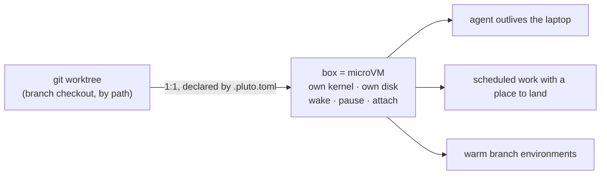
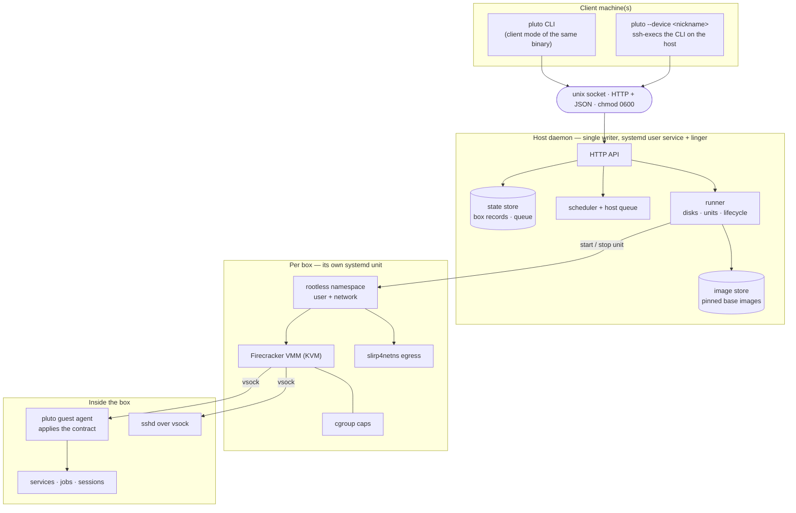
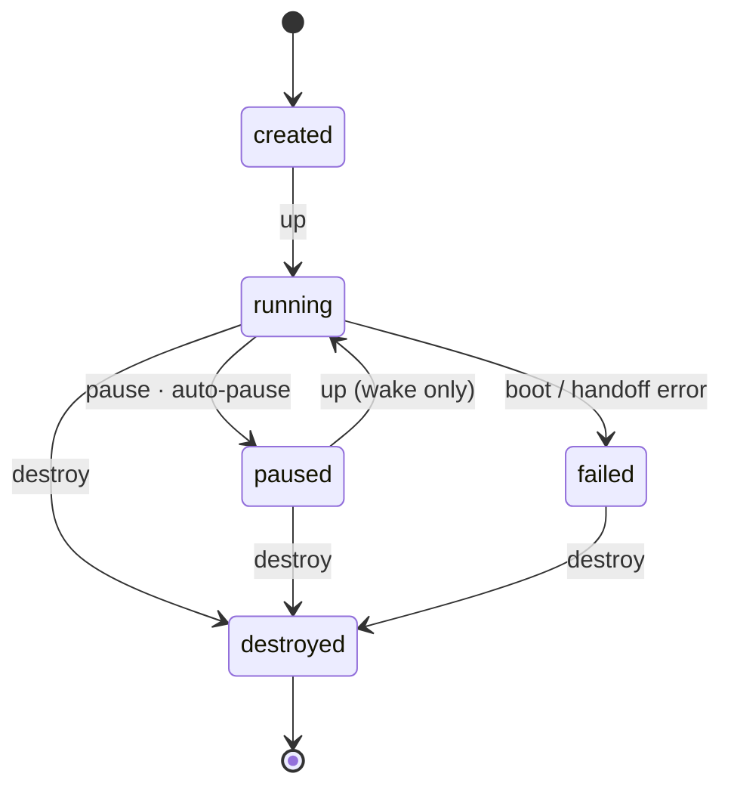
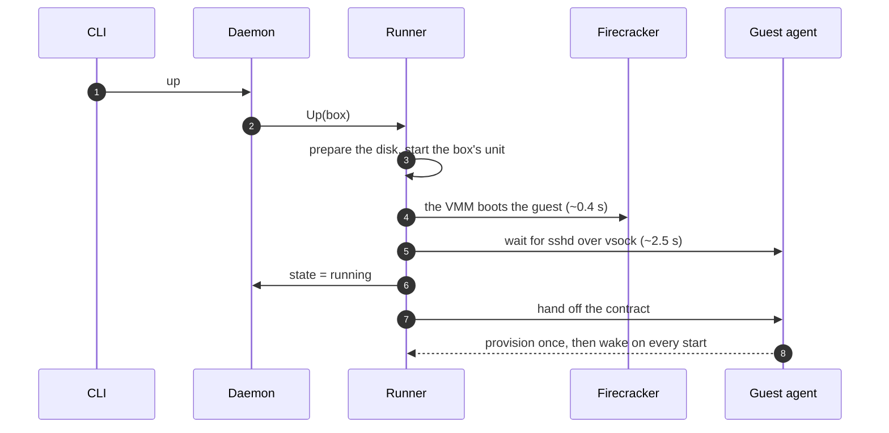
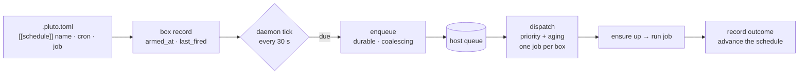
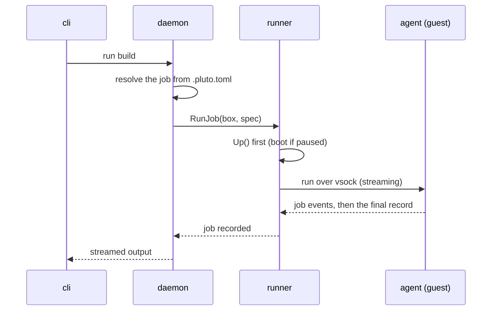

# pluto — Review 1 explainer

*A concept pass for the OS review: durable microVM boxes, the lifecycle, and job
scheduling. Diagrams render in any Markdown viewer with Mermaid support. Deeper
implementation notes live in `docs/adr/` and the code; this file stays at the
"how it works" level.*

pluto gives every git worktree a durable work machine: a microVM **box** that
wakes for work, sleeps when idle, and can be entered over SSH — on hardware you
own, with no accounts, no control plane, and no telemetry.

The claim is the **lifecycle**, not the storage: a machine that belongs to a
branch, wakes for work, sleeps when done, and can be entered. It is
agent-agnostic — an agent is just a declared job, service, or session.

---

## 1. The idea

Git is the unit of work; a box is the unit of compute. One worktree maps to one
box, and the box is declared by a repo-committed file, `.pluto.toml` (the **box
contract**).



Two phases separate expensive, once-per-box work from cheap, per-wake repair:

- **provision** — runs once for the life of the box's disk: installs, checkouts,
  setup too expensive to repeat. Leftover processes are discarded.
- **wake** — runs on every start: restart services, refresh credentials, repair
  what a pause discarded. Short and idempotent.

---

## 2. How it is put together

One host daemon owns every box and is the **single writer**. The CLI is the same
binary in client mode. Each box is its own systemd unit, so VMMs are never
daemon children — a daemon restart re-adopts running boxes.



The four boundaries that matter:

| Edge | Transport | Why |
| --- | --- | --- |
| CLI → daemon | unix socket, HTTP+JSON | local, permission-checked, no network port |
| daemon → box | systemd user unit | boxes outlive daemon upgrades |
| host → guest | vsock | no guest IP needed; sshd and the agent both ride it |
| guest → internet | slirp4netns | rootless egress without host privileges |

Recovery contract: a daemon restart re-adopts running boxes from their state
directories; a host reboot stops boxes, and `pluto up` wakes the ones you ask
for. Nothing is a daemon child.

---

## 3. What a box is

A box is a real virtual machine, not a process group.

| property | what it means |
| --- | --- |
| own kernel | it boots a pinned guest kernel, not the host's |
| own disk | a copy-on-write clone of a pinned base image; survives pause |
| minimal hardware | a small, fixed device model: block, network, vsock, serial |
| isolated and sized | a rootless namespace plus cgroup caps; reached over vsock |

The base image is reproducible and hash-locked (every input pinned), and a box
pins the image version it first booted with — so rebuilding never changes an
existing box.

---

## 4. Lifecycle

`pause` is the only dormant state in v1. Durability is git plus the host disk:
disk state is as of the last graceful stop, and anything not pushed does not
exist.



What `pluto up` does:



Auto-pause is one rule: no client attached **and** no job running for the idle
window (default 1 h, per-box override, `off` disables). The daemon reads the
live session count from the agent, so it never pauses on a guess. Pause is a
clean shutdown; the disk stays on the host.

---

## 5. Job scheduling

Schedules are **durable alarms** on the box record. A due occurrence is written
into a durable host queue *before* the schedule clock advances, so a crash
cannot lose or double-fire it.



The properties worth remembering:

- **Durable** — the queue lives on disk, so schedules survive restarts and
  reboots. A firing missed while the daemon was down becomes exactly one late
  run.
- **Coalescing** — repeated ticks for the same box and schedule collapse into
  the one active item, instead of growing a backlog.
- **Priority with aging** — explicit user work beats repository events, which
  beat cron; aging promotes waiting work so scheduled runs cannot starve.
- **One job per box** — a busy box leaves its occurrence pending rather than
  starting a concurrent run. There is also a host-wide running-box cap.
- **At-least-once** — a crash window can duplicate a run. That is the right bias
  for builds and agent work.

A nightly run, end to end: cron matches → the occurrence is enqueued → the box
wakes and `wake` runs (`provision` is long done) → the job runs in the box →
the outcome is recorded in job history, and the box auto-pauses when idle.
`pluto jobs` shows the run, `pluto logs --job last` reads it, `pluto attach`
enters the machine.

---

## 6. microVM vs container

Both isolate work on one host. The difference is where the boundary sits: a
container is a process group sharing your kernel; a microVM is a machine with
its own.

| axis | container | microVM (pluto) |
| --- | --- | --- |
| isolation boundary | namespaces + cgroups; shares the host kernel | hardware virtualization (KVM); separate guest kernel |
| kernel | the host's — every syscall hits it | its own; the VMM is the only host surface |
| startup | milliseconds; already-warm layers | ~0.4 s kernel boot, ~2.5 s to sshd |
| density | very high — dozens to hundreds per host | lower; sized in vCPUs and GiB per box |
| filesystem | overlay image layers | a raw, copy-on-write block device |
| pause / resume | freeze a process tree | clean power-off; snapshot/restore deferred |
| access | exec into a process namespace | SSH to a computer over vsock |
| failure mode | a kernel escape is a host escape | a guest must also break the VMM boundary |

- **Containers win** on density, speed, and ecosystem — simpler, faster, cheaper
  per box for trusted single-user work.
- **MicroVMs win** on being a real machine: own kernel and device model, a clean
  shutdown for a clean disk, a natural SSH boundary, stronger isolation.
- **The seam**: the runner drives a VMM through a thin interface from day one.
  Firecracker is the choice, not the architecture — a container backend could
  sit behind the same lifecycle.

The honest position: the durability lifecycle is what pluto is about, and it is
largely orthogonal to container-vs-microVM. If "own kernel" and stronger
isolation are not load-bearing for the target work, a container backend buys
density and startup time; if they are — untrusted code, real machine semantics,
clean disks — the microVM is the right default.

---

## 7. Using it

The host needs Linux x86_64 with a writable `/dev/kvm`; nothing here needs root.

```sh
# host setup
go run ./cmd/pluto-image-builder     # build the base image
pluto install                        # daemon as a systemd user service + linger
pluto image import images/out        # import it (hash-verified)
```

The contract, in the worktree:

```toml
[box]
auto_pause = "1h"

[provision]
command = ".pluto/provision.sh"     # once per box, on the durable disk

[wake]
command = ".pluto/wake.sh"          # every start, short and idempotent

[jobs.test]
description = "run the test suite"
command = "pnpm test"

[services.dev]
command = "pnpm dev"
port = 3000

[[schedule]]
name = "nightly"
cron = "0 2 * * *"
job = "test"
```

The everyday loop:

```sh
pluto up                 # create if absent, wake if paused
pluto status .           # state, phases, services, latest job
pluto run                # list declared jobs
pluto run test           # run one in the box
pluto run -- uname -a    # ad-hoc command (the guest kernel proves the microVM)
pluto attach             # interactive shell, wakes first
pluto jobs .             # recent job history
pluto logs . --job last  # newest job output
pluto pause . && pluto up .   # pause, then wake (wake runs again)
```

---

## 8. Where it stands

- **Real, today**: `up`, `run`, `attach`, `pause`, `status`, `ls`, `logs`,
  `jobs`, `destroy`; the two-phase contract; scheduled jobs with a durable host
  queue; auto-pause; a reproducible pinned image; rootless Firecracker over
  vsock.
- **Deferred, with revive triggers**: memory snapshots (wait for resume latency
  to hurt), the jailer (wait for a real trust boundary), Cloud Hypervisor (wait
  for a concrete capability), remote handoff and fleet.
- **Open for the review**: whether a container backend joins the microVM behind
  the same runner seam.

---

## 9. Codebase map

One Go module, **five binaries**, three layers: host control, host VMM
management, and guest. The review-1 path is
`cli → client → daemon → runner → Firecracker → vsock → agent`.

**Binaries (`cmd/`)**

| binary | role |
| --- | --- |
| `pluto` | the CLI and the host daemon — one binary, two modes |
| `pluto-agent` | the box-side agent, baked into the base image |
| `pluto-vsock` | a stdio ⇄ vsock bridge (ssh `ProxyCommand`) |
| `pluto-image-builder` | builds the base image |
| `pluto-schema` | generates the editor schema from the contract types |

**Host packages (`internal/`)** — where each idea lives

| package | responsibility |
| --- | --- |
| `cli` | parse and dispatch commands; client mode; remote `--device` |
| `client` + `api` | typed HTTP client and the wire vocabulary |
| `daemon` | the HTTP API, the auto-pause loop, the scheduler and queue |
| `runner` | the box lifecycle: disks, units, VMM launch, handoff, jobs, logs |
| `state` | the single-writer state dir: box records, queue, jobs, schedules |
| `contract` | parse and validate `.pluto.toml`, cron, contract hash |
| `systemd` | the daemon unit, the per-box unit template, cgroup caps |
| `vsock` | host-side dialing and guest-side listening |
| `imagebuilder` | the pinned, reproducible base image |
| `envcache` | opt-in reusable provisioned layers |

**Guest (`internal/agent/`)** — one process in the box that applies the
contract (provision, wake, services, sessions), runs jobs, and reports status;
it speaks a small newline-JSON protocol over vsock.

**Follow one command: `pluto run build`**



**Elsewhere in the repo**: `docs/adr/` holds the decisions; `GLOSSARY.md` holds
the shared vocabulary; `images/` holds the base-image recipe; `scripts/` holds
the real-host end-to-end runs; `.github/workflows/` holds CI and the image
build.

---

## Appendix: live demo wiring

The Review 1 demo runs against the `siddhant.foo` project (an Astro site with
bun + mise), whose contract declares `provision`, `wake`, jobs, services, and a
nightly build schedule. See [review-1-demo.md](review-1-demo.md) for the exact
commands and the current state of the running demo.
