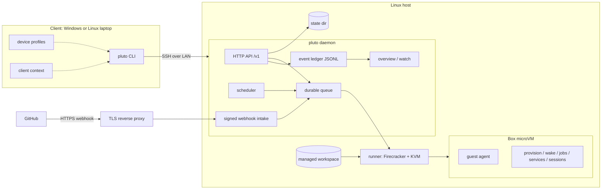
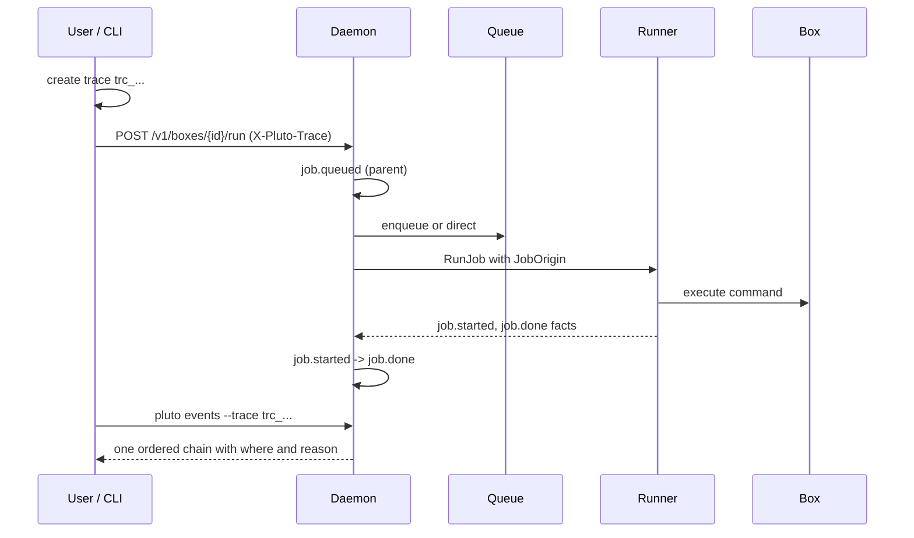
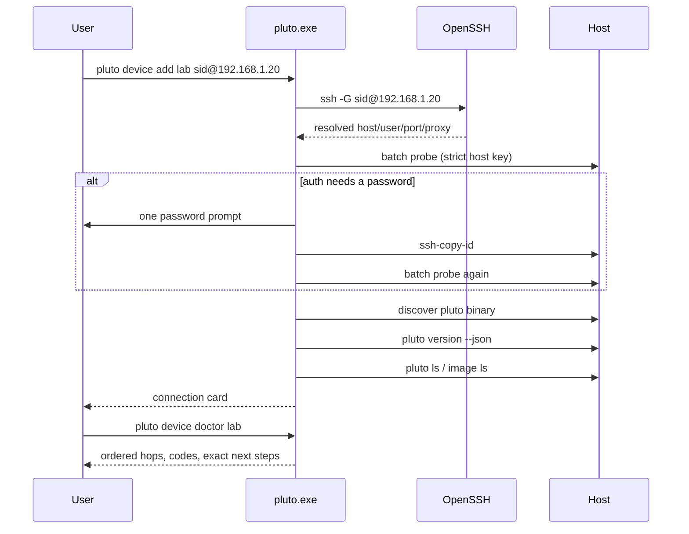
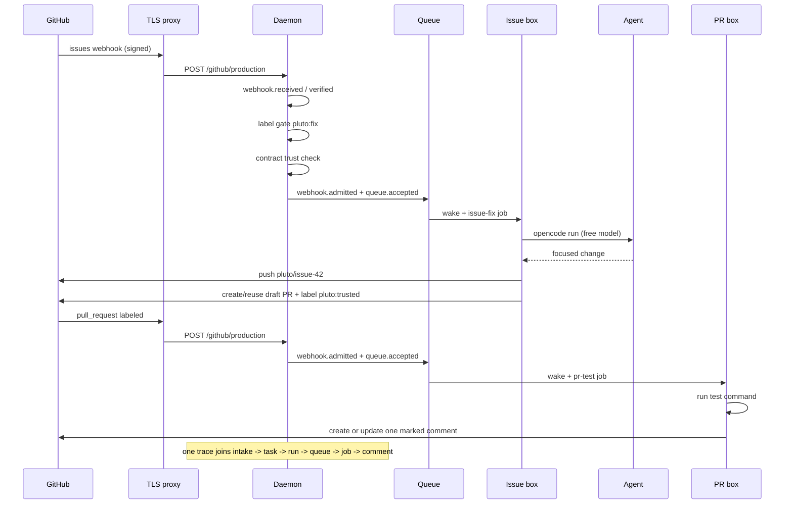

# Pluto R3 — complete briefing

> **What this document is.** A single, self-contained briefing for the R3 slice of
> Pluto. It is written so a teammate can build a slide deck and a written report
> from it without reading the code. It covers the idea, the architecture, every
> shipped feature, the data model, the process flows, the CLI/API surface, what
> is verified, and what is deliberately still pending.
>
> **Code reviewed at:** `demo/windows-client` @ `3c6fcb0` (R3 integration,
> 10 tickets, ~139 files, ~22k inserted lines).
> **Spec:** GitHub issue #164; child tickets #165–#174.
> **Design narrative:** [`docs/r3-plan.md`](docs/r3-plan.md).
> **Runbook:** [`docs/review-3-demo.md`](docs/review-3-demo.md).

---

## 1. The one-paragraph idea

Pluto turns a Linux host into a pool of **durable work machines** called
**boxes**. A box is a Firecracker microVM with its own disk; it can be paused,
woken, attached to, and destroyed, and its work survives the laptop that asked
for it. A small CLI talks to a host daemon over SSH (from Windows or Linux) and
over a local unix socket (on the host). R3 makes that system **explainable and
repeatable**: every decision leaves a durable event with a trace id, the laptop
can create and address work from its own checkout without a box id, devices
onboard durably, schedules are inspectable, and a real GitHub issue can drive an
agent to a draft PR whose tests post one stable comment back.

The short version for a slide:

> **Review 2 showed a box and a job. Review 3 shows the system: what happened,
> where, when, and why — from a laptop checkout, through a schedule or a GitHub
> event, to a durable result.**

---

## 2. Why R3 exists (the problem)

Before R3, the automated side existed but was mostly invisible:

| Area | Before R3 | After R3 |
|---|---|---|
| Activity history | Job/task state only; decisions went to journald as prose | Append-only event ledger with sequence, trace, actor, place, reason |
| Host view | One box at a time | `watch` / `overview` / `health` for the whole host |
| Trigger identity | A job did not record whether a human, schedule, or webhook started it | Every job carries `source`, `origin`, `trace_id`, task/run/queue/schedule/event ids |
| Laptop workflow | Needed a host worktree path or box id | `pluto --device host up`, `pause`, `status`, `run`, `attach`, `logs`, `job ls` resolve the checkout's project+branch |
| Workspace | One clone per `up --repo`, always the default branch | Project registry, managed clones, one worktree per branch, locked and guarded |
| Device setup | Saved `user@host` before probing; ignored `~/.ssh/config` | OpenSSH profiles, `ssh -G`, ordered preflight, doctor, one-password key install, strict host keys |
| Schedules | Fired, but no next-due, last outcome, or run-now | `schedule ls/show/run`, durable skip/failure reasons |
| Webhooks | Flags only; rejections were HTTP errors | Persisted runtime sources, redacted status, intake events, `pluto trust` |
| GitHub loop | Webhook plumbing existed; no end-to-end issue→PR→comment story | Label gate, deterministic branch, draft PR, PR test job, one marked comment |

---

## 3. What R3 proves (the review story)

R3 is one LAN demo with a server that has inbound internet:

1. A Windows laptop connects to a Linux host and can explain the connection
   (`device add`, `device doctor`).
2. From the laptop checkout, `pluto --device host up` creates or resumes the
   branch's managed worktree and box without a host path or box id.
3. `pause`, `run`, `status`, `attach`, `logs`, and `job ls` resolve the same
   target.
4. A schedule fires while the box is paused, wakes it, runs a job, and leaves a
   durable result.
5. A real GitHub issue labelled `pluto:fix` is delivered by webhook to the
   server; an agent job commits to `pluto/issue-<n>` and opens or reuses a draft
   PR.
6. A PR delivery runs tests and creates or updates exactly one marked comment.
7. Every step is visible in `watch`, `events --trace`, `timeline`, `task show`,
   and `run logs`.

**Network truth:** the client↔server leg is LAN/hotspot only. GitHub talks to
the server's public HTTPS webhook endpoint; GitHub never talks to the laptop.
No Tailscale, relay, or tunnel is used for R3. The Pluto control API is never
public.

---

## 4. Feature inventory

### 4.1 Durable event ledger and observability

| Capability | What it does |
|---|---|
| Event record | One JSON object per line: schema, monotonic `seq`, stable `id`, UTC `at`, `kind`, `level`, `trace_id`, `parent_id`, `actor`, flat `where`, `summary`, `duration_ms`, `reason`, small non-secret `attrs` |
| Trace propagation | A trace id is created at the first cause (manual command, schedule occurrence, webhook delivery) and carried through queue → task → run → job → events |
| Correlation fields | Jobs carry source/origin/trace/task/run/queue/schedule/event ids; tasks, runs, and queue items carry trace and actor |
| Retention | 30 days or 1,000,000 events, 64 MiB segments; `PLUTO_EVENT_RETENTION` overrides; whole segments rotate |
| Redaction | Payload bodies, tokens, secrets, environment values, and argv are never written; size/hash may be |
| Read API | `GET /v1/events` (filters, newest first) and `GET /v1/events/stream` (SSE) over the unix socket only |
| CLI | `pluto events` with `--box`, `--kind`, `--trace`, `--since`, `--limit`, `--follow`, `--json` |
| Causal view | `pluto timeline <box|task|run|trace>` in sequence order; `pluto status` shows the latest event and trace |

### 4.2 Live operations view

| Capability | What it does |
|---|---|
| `pluto watch` | Refreshes one fixed-width frame in place: daemon/version/uptime, state dir, boxes, queue, active jobs, schedules, webhook sources, live event tail |
| `pluto overview [--json]` | The same aggregate once; static read for screenshots and diagnosis |
| `pluto health` | Daemon status, version, state version, uptime, socket, state dir, box count |
| `GET /v1/overview` | Read-only aggregate used by the CLI |
| Failure visibility | `!` for errors (failed job/schedule, rejected webhook), `~` for warnings (blocked queue, skipped schedule); plain text first, color optional |
| Screenshot mode | `pluto watch --once`, `NO_COLOR=1`, `PLUTO_WATCH_WIDTH=120` |
| No platform creep | No browser, no public listener, no Prometheus/OTel/Grafana, no alerting, no time-series DB |

### 4.3 Default targets from the client checkout

| Capability | What it does |
|---|---|
| Client context | The laptop sends project name, source URL, branch, HEAD, dirty flag, and selected remote as **metadata**, never authorization |
| `up` | `pluto --device host up` registers/clones the project, creates or resumes `<project>-<branch>` under `~/.pluto/worktrees`, and creates/resumes the box |
| No box id | `pause`, `status`, `run`, `attach`, `logs`, `job ls`, and `task create` resolve the same project+branch |
| Overrides | An explicit box id, worktree key, `project@branch`, path, or `--worktree` always wins |
| Safety | A local branch ahead of or absent from the remote fails with `next: git push -u origin <branch>`; no silent stale code, no bundle upload |
| No context | Outside a checkout, no-target commands fail and list registered projects instead of guessing |

### 4.4 Managed projects and worktrees

| Capability | What it does |
|---|---|
| Root | `~/.pluto` (`PLUTO_HOME` override): `projects.toml`, `repos/<project>`, `worktrees/<key>`, `.locks/` |
| Registry | `pluto project add/ls/show/rm`; one clone per project; default branch detected |
| Keys | `<project>-<sanitized-branch>`; exact form `project@branch`; collisions append a short hash |
| Locking | Per-project blocking lock (`flock` on unix, O_EXCL fallback); clone/worktree creation is atomic |
| Branches | Remote-only branch becomes a tracking branch; a missing remote branch is a clear error |
| Guards | `worktree rm` / `project rm` refuse dirty checkouts or live boxes unless `--force` |
| Identity | Box identity is project+branch; moving a managed checkout can reattach the box instead of creating a second one |
| Missing disk | A box whose worktree is missing fails loudly; it is never silently recreated |
| Sync boundary | Git-once: committed refs only; no watcher, no bidirectional sync, no dirty-file copy |

### 4.5 Durable device onboarding

| Capability | What it does |
|---|---|
| Profiles | Destination alias or raw target, optional port, identity file, ProxyJump, remote path policy, platform, auth mode, trust mode, ControlMaster opt-in |
| Source of truth | The profile points at OpenSSH; `ssh -G` is used for display/diagnostics, not as a frozen replacement |
| `device add` | Ordered preflight: SSH present → config resolves → host key → auth → remote shell → binary discovery → version handshake → daemon → state → image; prints a connection card |
| One password | Offers `ssh-copy-id` once on a TTY; prints the PowerShell equivalent on Windows if unavailable; never stores a password |
| Binary discovery | Explicit path → cache → non-interactive `command -v` → login-shell `command -v` → known absolute paths; must be an executable regular file |
| Version handshake | Machine-readable `version --json` with protocol/capabilities; legacy text versions tolerated with a warning |
| `device doctor` | Read-only ordered hops with ok/warn/failed/skipped, stable codes, exact next steps; `--json`, `--print-ssh`, `--offline` |
| `device ls` | Connected / unverified / offline with version and last-seen, so a saved-but-broken device is visible |
| Transport | One quoted remote command through `sh -c`; `-T` for non-interactive, `-tt` only for attach; connect timeouts and keepalives |
| Host keys | Strict by default; `--trust accept-new` is the explicit first-use opt-in |
| Windows | Uses `ssh.exe` directly, the Windows ssh-agent, and no ControlMaster; never routes work through `cmd.exe` |
| No install | The client never installs or updates the host binary; missing/mismatched output prints exact host-side commands |

### 4.6 Schedules

| Capability | What it does |
|---|---|
| `schedule ls [box]` | Box, name, cron, next due, last fired, last outcome/reason, last run/job |
| `schedule show <box> <name>` | Definition plus occurrence history |
| `schedule run <box> <name>` | Materializes one explicit occurrence now without moving the cron clock; daemon dedupes a retried request by idempotency key |
| Scheduler | Evaluates every 30 seconds; catches up missed occurrences once after restart; wakes a paused box through the normal queue |
| Events | `schedule.fired`, `schedule.caught_up`, `schedule.skipped`, `schedule.failed` with the reason |
| Warm-up | A schedule with no job is still listed and still wakes the box |
| Trust | A scheduled job requires an approved contract revision; a skip records why |

### 4.7 Contract trust and webhook operations

| Capability | What it does |
|---|---|
| `pluto trust [box]` | Shows the current contract revision, declared jobs, and event policy; confirms or `--yes`; calls the existing contract-trust API; resolves the client checkout when no target is given |
| `webhook add` | Persists a source in host state and registers it at runtime; no daemon restart; existing flags still work |
| `webhook ls` | Source, kind, endpoint, secret-present flag, box, last delivery, accepted/rejected counts, last rejection reason; never returns the secret |
| `webhook rm/test` | Remove a source; send a signed local test delivery clearly labelled as a test |
| Intake events | `webhook.received/verified/rejected/deduped/ignored/admitted` with delivery id, repo, ref, object id, size, hash |
| Secret handling | State stores the environment-variable **name**, never the value |
| Reuse | Signature verification, event parsing, delivery dedupe, trust checks, and task/queue admission are the existing implementation, not a rewrite |

### 4.8 GitHub issue → draft PR → test comment

| Capability | What it does |
|---|---|
| Issue gate | Only issues with `pluto:fix` are admitted (declarative `labels = ["pluto:fix"]`); an unlabelled issue records a durable `webhook.ignored` reason and creates no work |
| Issue job | Runs on the issue work-item box with the signed payload; agent makes a focused change; commits to `pluto/issue-<n>`; pushes; opens or reuses a **draft** PR linked to the issue; labels its own same-repository PR `pluto:trusted` |
| PR job | `opened`/`labeled`/`synchronize`/`reopened`/`ready_for_review` runs the declared test command on the PR work-item box |
| One comment | Creates or updates exactly one comment with the hidden marker `<!-- pluto:test-report -->`, including on failure; body has result, command, duration, head, and task/run/trace links |
| Loop safety | The PR job only comments; it never pushes, approves, or merges, so a failing test cannot loop |
| Trust | Unlabelled and fork PRs get no host credentials; they may run tests but cannot comment; a fork is untrusted regardless of label |
| Tokens | `PLUTO_ISSUE_TOKEN` (contents + pull-request write) and `PLUTO_PR_TOKEN` (comment-only); values live in the daemon environment, the contract stores only names |
| Trace | One trace joins webhook intake → task → run → queue → job → comment |

### 4.9 Demo harness and docs

| Artifact | Purpose |
|---|---|
| `demo/r3/.pluto.toml` | Sample contract: heartbeat job on a 2-minute schedule, issue-fix, PR-test, `auto_pause = "5m"`, tools, provision |
| `scripts/pluto-demo-heartbeat` | Records date, host, pwd, trigger class, and task/run/trace |
| `scripts/pluto-demo-provision` | Installs OpenCode once per box disk with the official installer |
| `scripts/pluto-issue-fix` | Real issue job; default agent is `opencode run --standalone --auto --model opencode/deepseek-v4.1-flash-free` (free, no auth) |
| `scripts/pluto-pr-test` | Runs the test command and updates the marked comment |
| `scripts/pluto-demo-agent` | Deterministic stand-in agent for no-network boxes; explicitly **not** a real agent run |
| `scripts/pluto-demo-test` | Deterministic stand-in test that checks the PR head has a committed change |
| `scripts/r3-demo-preflight.sh` | Checks host prerequisites without mutating state |
| `docs/review-3-demo.md` | Full runbook, network truth, known gaps, run record |
| `docs/demo/r3/README.md` | Screenshot checklist; every shot is **pending** until a real run records it |

---

## 5. Architecture

### 5.1 Topology

```text
┌──────────────────────────┐        SSH over LAN / hotspot        ┌─────────────────────────────────────────────┐
│ Windows laptop (client)  │ ───────────────────────────────────▶ │ Linux host                                  │
│                          │                                      │                                             │
│ pluto.exe                │                                      │ pluto daemon                                │
│  ├─ device profiles      │                                      │  ├─ unix socket: full control API           │
│  ├─ client context       │                                      │  ├─ scheduler (30s) + durable queue         │
│  └─ remote re-exec       │                                      │  ├─ event ledger (JSONL)                    │
│                          │                                      │  ├─ overview / watch read models            │
│ ~/.config/pluto/         │                                      │  └─ signed webhook listener                 │
│   devices.toml           │                                      │                                             │
└──────────────────────────┘                                      │ state: ~/.local/state/pluto                 │
                                                                  │ workspace: ~/.pluto                         │
┌──────────────────────────┐   HTTPS webhook (public ingress)      │                                             │
│ GitHub                   │ ───────────────────────────────────▶ │ TLS reverse proxy → /github/<source>        │
│  issues / pull requests  │                                      │                    /generic/<source>        │
└──────────────────────────┘                                      │                                             │
                                                                  │ Firecracker + KVM                           │
                                                                  │  ├─ box A (microVM, disk survives pause)    │
                                                                  │  ├─ box B ...                               │
                                                                  │  └─ guest agent: provision/wake/jobs/       │
                                                                  │      services/sessions                      │
                                                                  └─────────────────────────────────────────────┘
```

Key boundary: **GitHub never talks to the laptop.** The server has full inbound
internet for the signed webhook; the client-to-server leg stays LAN-only. The
control API is a unix socket and is never exposed.

### 5.2 Mermaid architecture



### 5.3 Components

| Component | Package / path | Responsibility |
|---|---|---|
| CLI | `cmd/pluto`, `internal/cli` | One binary, client and daemon modes; commands, output voice, help, exit codes |
| Remote client | `internal/remotecli` | `--device` re-exec over SSH; device add/doctor; remote help |
| Client context | `internal/clientcontext` | Detect the laptop checkout (root, remote, project, branch, HEAD, dirty) and encode `PLUTO_CLIENT_CONTEXT` |
| Typed client | `internal/client` | HTTP over the unix socket; trace/client headers; typed event, schedule, webhook, overview calls |
| Wire types | `internal/api` | Request/response vocabulary shared by daemon and client |
| Daemon | `internal/daemon` | HTTP API, queue dispatch, scheduler, webhooks, trust, overview, event recording |
| State | `internal/state` | Durable box, queue, task, run, schedule, webhook, and trust records |
| Event ledger | `internal/events` | Append-only JSONL, sequence, rotation, retention, filters, subscriptions |
| Workspace | `internal/workspace` | Project registry, clones, worktrees, keys, locks, guards |
| Devices | `internal/devices` | OpenSSH profiles, `ssh -G`, cache, probes, doctor hops, binary discovery, handshake, copy-id |
| Runner | `internal/runner` | Firecracker lifecycle, disk, phases, jobs, services, sessions, environment cache, observer |
| Guest agent | `internal/agent` | In-box agent for phases, jobs, services, sessions |
| Contract | `internal/contract` | `.pluto.toml` parsing/validation, cron math, trust revision |
| GitHub loop | `internal/githubloop` | Shared script names, labels, branch naming, comment marker, env names |
| Handshake | `internal/handshake` | Version/protocol/capabilities for client↔host compatibility |
| Providers | `internal/provider` | Optional access providers (Tailscale, OpenTunnel) — existing |
| Demo scripts | `scripts/` | Repo-owned heartbeat, provision, issue-fix, PR-test, stand-ins, preflight |

### 5.4 Filesystem layout

**Daemon state** (`$PLUTO_STATE_DIR`, default `~/.local/state/pluto`):

```text
boxes/<box-id>/box.json      box record, phases, services, sessions, jobs, schedules
queue.json                   durable queue items
tasks.json                   durable tasks and runs
events/                      events-NNNNNN.jsonl + index.json
webhooks.json                persisted webhook sources (secret env names only)
images/                      imported base images
projects/tasks/              legacy isolated task worktrees (readable, not new)
```

**Managed workspace** (`$PLUTO_HOME`, default `~/.pluto`):

```text
projects.toml                project registry
repos/<project>/             one normal clone per project (default branch)
worktrees/<project>-<branch> one flat checkout per non-default branch
worktrees/<project>-task-<key> new isolated task worktrees
.locks/                      per-project and registry locks
```

**Client**:

```text
~/.config/pluto/devices.toml       device profiles (no secrets)
$PLUTO_STATE_DIR/devices/          disposable resolved/cached facts
~/.ssh/config                      still the source of truth for SSH
```

**Box disk** (survives pause): provisioned tools, repo checkout, job output,
agent state. The base image is read-only and content-addressed.

---

## 6. Data model

### 6.1 Event record

```json
{
  "schema": 1,
  "seq": 1842,
  "id": "evt_4f9a2c1d8e7b6a50",
  "at": "2026-10-22T14:31:02.184Z",
  "kind": "webhook.admitted",
  "level": "info",
  "trace_id": "trc_4f9a2c1d8e7b6a50",
  "parent_id": "evt_...",
  "actor": {"type": "github", "id": "delivery-...", "client": "", "host": "neptuno"},
  "where": {
    "host": "neptuno",
    "box_id": "b75b12c9-...",
    "project": "cipher",
    "branch": "demo/pluto",
    "worktree": "/home/sid/.pluto/worktrees/cipher-demo-pluto",
    "task_id": "",
    "run_id": "",
    "job_id": "",
    "queue_id": "",
    "schedule": "",
    "event_source": "production",
    "delivery_id": "..."
  },
  "summary": "issue #42 admitted for issue-fix",
  "duration_ms": 0,
  "reason": "",
  "attrs": {"repo": "Siddhj2206/cipher", "ref": "refs/heads/main", "object_id": "42", "size": "8123", "sha256": "..."}
}
```

Rules:

- `seq` is the ordering key, assigned by the single writer; timestamps are not
  ordering.
- `trace_id` starts at the first cause and is inherited by every derived event.
- `parent_id` points at the direct cause when there is one.
- `where` is flat so readers can filter without joins.
- `attrs` is small and non-secret. Payload bodies, tokens, secrets, env values,
  and argv never appear.
- Event kinds are prefix-filterable, so an older CLI can read a newer ledger.

### 6.2 Correlation fields

| Record | Added fields |
|---|---|
| `state.Job` | `source`, `job_origin`, `trace_id`, `task_id`, `run_id`, `queue_id`, `schedule_name`, `event_source`, `event_id` |
| `state.Task` | `trace_id`, `actor` |
| `state.TaskRun` | `trace_id`, `actor`, `queue_source` |
| `state.QueueItem` | `trace_id`, `actor` |
| `state.Schedule` | `last_outcome`, `last_reason`, `last_run_id`, `last_job_id`, response-only `next_due_at` |
| `state.EventContext` | `labels`, `trusted`, `credential_names`, `payload` (payload stays in state, never the ledger) |

Zero values mean "unknown", so records written before R3 remain readable.

### 6.3 Event kind catalog (schema 1)

| Area | Kinds |
|---|---|
| daemon | `daemon.started`, `daemon.stopped`, `daemon.reloaded`, `daemon.error` |
| box | `box.created`, `box.wake.started`, `box.wake.done`, `box.pause.started`, `box.pause.done`, `box.failed`, `box.destroyed` |
| phases | `phase.provision.started/done/failed`, `phase.wake.started/done/failed`, `phase.service.changed` |
| sessions | `session.started`, `session.attached`, `session.detached`, `session.stopped` |
| jobs | `job.queued`, `job.started`, `job.done`, `job.failed`, `job.cancelled` |
| queue | `queue.accepted`, `queue.rejected`, `queue.dispatched`, `queue.blocked`, `queue.recovered`, `queue.done`, `queue.failed` |
| tasks | `task.created`, `task.run.queued`, `task.run.started`, `task.run.done`, `task.run.failed`, `task.run.blocked` |
| schedules | `schedule.armed`, `schedule.fired`, `schedule.skipped`, `schedule.failed`, `schedule.caught_up` |
| event intake | `event.received`, `event.verified`, `event.rejected`, `event.admitted`, `event.deduped`, `event.ignored` |
| webhooks | `webhook.received`, `webhook.verified`, `webhook.rejected`, `webhook.deduped`, `webhook.ignored`, `webhook.admitted` |
| contract | `contract.applied`, `contract.stale`, `contract.approved`, `contract.rejected` |
| host | `image.imported`, `provider.changed` |

### 6.4 Persisted webhook source

```json
{
  "schema": 1,
  "sources": [
    {
      "source": "production",
      "kind": "github",
      "box_id": "b75b12c9-...",
      "secret_env": "PLUTO_GITHUB_WEBHOOK_SECRET",
      "last_delivery_at": "2026-10-22T14:31:02Z",
      "last_delivery_id": "...",
      "last_event": "issues",
      "last_outcome": "admitted",
      "accepted": 4,
      "rejected": 1,
      "last_rejected_at": "...",
      "last_rejection_reason": "invalid signature"
    }
  ]
}
```

The secret is an environment-variable **name**. `secret_present=false` means the
source is listed but not receiving, because the daemon environment does not have
that variable.

### 6.5 Project registry

```toml
[project.cipher]
source = "https://github.com/example/cipher.git"
default_branch = "main"
clone = "/home/me/.pluto/repos/cipher"
created_at = 2026-10-22T14:00:00Z
last_fetch = 2026-10-22T14:01:00Z
```

---

## 7. Process flows

### 7.1 A manual run leaves one causal chain



Read it with:

```sh
pluto events --trace trc_...
pluto timeline trc_...
```

### 7.2 `up` from a laptop checkout

1. The client runs `git rev-parse`/`git remote` in the laptop checkout.
2. It builds `PLUTO_CLIENT_CONTEXT`:
   `{"project","branch","source","remote","head","dirty"}`.
3. `--device host` re-execs `pluto up` on the host with that environment.
4. The host registers the project (clone once) and ensures the managed
   worktree `<project>-<branch>`.
5. It creates or resumes the box keyed by project+branch.
6. A second `up` finds the same box and wakes it.
7. If the branch is not on the remote, it fails with
   `next: git push -u origin <branch>`.

```sh
# On the laptop, inside the checkout
pluto --device lab up
pluto --device lab status
pluto --device lab pause
pluto --device lab attach
```

Explicit override always wins:

```sh
pluto --device lab status cipher@demo/pluto
pluto --device lab up --worktree cipher-demo-pluto
```

### 7.3 Device onboarding and doctor



Hop order: local SSH → config resolution → DNS/TCP → proxy → host key → auth →
remote shell → binary discovery → version/protocol → daemon → state → image.

On a fresh host, the first `device add` stops at the unknown host key with the
exact `--trust accept-new` hint; rerun with that flag for explicit first-use
acceptance. After that, the profile is strict.

### 7.4 A schedule fires on a paused box

1. The daemon evaluates schedules every 30 seconds.
2. A due occurrence is materialized as a durable task/run and queue item.
3. The contract revision must be approved; otherwise `schedule.skipped` with a
   reason.
4. Dispatch wakes the box (`box.wake.started` → `phase.wake.*` →
   `box.wake.done`).
5. The job runs (`job.started` → `job.done/failed`).
6. The schedule records `last_outcome`, `last_reason`, `last_run_id`,
   `last_job_id`.
7. A missed occurrence after restart is materialized once, not duplicated.

```sh
pluto schedule ls
pluto schedule show mybox nightly
pluto schedule run mybox nightly   # explicit occurrence, cron clock unchanged
```

### 7.5 GitHub issue → draft PR → test comment



Important detail: the first `opened` delivery is **untrusted** because the issue
job labels the PR after creation. Tests run but no comment is posted. The
following `labeled` delivery is trusted and posts the one comment; later
`synchronize` deliveries update it. The sample policy includes `labeled` for
this reason.

### 7.6 Ledger write and read path

```text
daemon handler / scheduler / runner fact
        │
        ▼
Server.record (fills host, box, trace, actor, where)
        │
        ▼
events.Store.Append (single writer, seq++, O_APPEND JSONL)
        │
        ├─▶ GET /v1/events (filtered, newest first)
        ├─▶ GET /v1/events/stream (SSE)
        ├─▶ pluto events / timeline
        └─▶ pluto watch / overview / status
```

Rotation happens before the next append when a segment reaches 64 MiB.
Retention deletes whole closed segments, never the active one.

---

## 8. CLI reference (R3 surface)

### 8.1 New or extended commands

| Command | Example | Purpose |
|---|---|---|
| `pluto events` | `pluto events --since 1h --kind job.` | Read the ledger; filters, follow, JSON |
| `pluto timeline` | `pluto timeline trc_4f9a2c1d` | One causal chain |
| `pluto watch` | `pluto watch --interval 5s` | Live host view, refreshes in place |
| `pluto overview` | `pluto overview --json` | One static aggregate |
| `pluto health` | `pluto health` | Daemon identity and uptime |
| `pluto trust` | `pluto trust mybox --yes` | Approve the exact contract revision |
| `pluto schedule ls/show/run` | `pluto schedule run mybox nightly` | Inspect and materialize schedules |
| `pluto webhook add/ls/rm/test` | `pluto webhook ls --json` | Manage signed sources |
| `pluto project add/ls/show/rm` | `pluto project add <url>` | Project registry |
| `pluto worktree ls/rm` | `pluto worktree ls cipher` | Managed branch worktrees |
| `pluto device add/doctor/ls/rm` | `pluto device doctor lab --json` | Durable onboarding |
| `pluto up` | `pluto up cipher --branch demo/pluto` | Managed worktree + box |
| `pluto version --json` | `pluto version --json` | Version/protocol handshake |

Existing commands (`run`, `task`, `job`, `queue`, `jobs`, `logs`, `attach`,
`connect`, `pause`, `status`, `ls`, `destroy`, `image`, `init`, `setup`,
`daemon`, `install`, `uninstall`, `provider`) keep their grammar and exit codes;
R3 adds behavior and output additively.

### 8.2 Target resolution

```text
explicit box id / worktree key / project@branch / path / --worktree
        > client context (laptop checkout)
        > host current worktree
        > failure with the registered-projects list
```

`--worktree` on a client is always a **host-side** managed key or absolute host
path, never the laptop path.

---

## 9. Daemon API reference

All routes below are on the **unix socket**. The only network listener is the
signed webhook intake.

| Method | Path | Purpose |
|---|---|---|
| GET | `/v1/health` | status, version, state version, uptime, socket, state dir, boxes |
| GET | `/v1/overview` | aggregate for `overview`/`watch` |
| GET | `/v1/events` | filtered event list |
| GET | `/v1/events/stream` | SSE event stream |
| GET | `/v1/schedules` | all schedules with next due/outcome |
| POST | `/v1/boxes/{id}/schedules/{name}/run` | explicit occurrence |
| GET | `/v1/webhooks` | redacted source status |
| POST | `/v1/webhooks` | persist + register a source |
| DELETE | `/v1/webhooks/{source}` | remove a source |
| POST | `/v1/webhooks/{source}/test` | signed in-process test delivery |
| GET | `/v1/boxes` | list boxes |
| POST | `/v1/boxes` | create/reuse a box |
| GET | `/v1/boxes/{id}` | one box |
| DELETE | `/v1/boxes/{id}` | destroy |
| POST | `/v1/boxes/{id}/up` | wake |
| POST | `/v1/boxes/{id}/pause` | pause |
| POST | `/v1/boxes/{id}/attach` | prepare SSH attach |
| POST | `/v1/boxes/{id}/connect` | prepare service access |
| POST | `/v1/boxes/{id}/run` | run a job or command |
| GET/POST | `/v1/boxes/{id}/contract-trust` | read/approve the exact revision |
| POST | `/v1/boxes/{id}/queue` | enqueue work |
| GET | `/v1/queue` | queue items |
| POST/GET | `/v1/tasks`, `/v1/tasks/{id}` | durable tasks |
| POST | `/v1/tasks/{id}/runs` | append a run |
| GET | `/v1/tasks/{id}/runs/{run_id}` | one run |
| GET | `/v1/boxes/{id}/logs` | phase/service/job logs |
| GET | `/v1/boxes/{id}/metrics` | raw Firecracker metrics |
| POST/GET | `/v1/images` | import/list images |
| POST | `/github/{source}` | signed GitHub intake |
| POST | `/generic/{source}` | signed generic intake |

---

## 10. Configuration and environment

| Variable | Where | Meaning |
|---|---|---|
| `PLUTO_HOME` | host | Managed workspace root; default `~/.pluto` |
| `PLUTO_STATE_DIR` | host | Daemon state; default `~/.local/state/pluto` |
| `PLUTO_SOCKET` | host/client | Unix socket path; default `$XDG_RUNTIME_DIR/pluto/pluto.sock` |
| `PLUTO_EVENT_RETENTION` | daemon | `age=720h,count=1000000`; `0` disables a bound |
| `PLUTO_WATCH_WIDTH` | client | Frame width, default 120, clamped 100–240 |
| `NO_COLOR` / `TERM=dumb` | client | Disable color |
| `PLUTO_CLIENT_CONTEXT` | client→host | Non-authoritative checkout metadata |
| `PLUTO_DEVICE_CACHE_DIR` | client | Disposable device cache |
| `PLUTO_SSH` | client | Explicit `ssh` binary |
| `PLUTO_GITHUB_WEBHOOK_SECRET` | daemon | HMAC secret for the GitHub source |
| `PLUTO_ISSUE_TOKEN` | daemon | Issue job token: contents + pull-request write |
| `PLUTO_PR_TOKEN` | daemon | PR job token: comment-only |
| `PLUTO_ISSUE_MODEL` | issue job | OpenCode model; default `opencode/deepseek-v4.1-flash-free` |
| `PLUTO_ISSUE_AGENT` | issue job | Full agent command override |
| `PLUTO_PR_TEST_COMMAND` | PR job | Test command; default `go test ./...` |
| `PLUTO_PR_TEST_TAIL` | PR job | Output lines quoted in the comment; default 40 |
| `PLUTO_EVENT_*` | job | Injected event facts: kind, action, repo, ref, head_ref, object_id, url, payload, labels, trusted |
| `PLUTO_TASK_ID`, `PLUTO_RUN_ID`, `PLUTO_TRACE_ID`, `PLUTO_WORKTREE`, `PLUTO_TASK_PROMPT` | job | Injected identity/location |
| `ISSUE_TOKEN`, `PR_TOKEN` | job | Script fallbacks for the documented `PLUTO_` names |

A contract's `[env]` may not declare `PLUTO_*`; credentials are the exception,
but they may not shadow injected identities (`PLUTO_EVENT_*`, `PLUTO_TASK_*`,
`PLUTO_TRACE_ID`, `PLUTO_WORKTREE`, `PLUTO_RUN_ID`).

---

## 11. Security and trust model

| Boundary | Rule |
|---|---|
| Control API | Unix socket only; never public |
| Webhook listener | Only `/github/<source>` and `/generic/<source>`; signed; loopback by default behind a TLS proxy |
| SSH | Client↔host; host keys strict by default; first-use acceptance is an explicit `--trust accept-new` |
| Device registry | No secrets; passwords are used only for the one `ssh-copy-id` prompt |
| Contract | The trusted default branch defines jobs/events; the exact revision must be approved |
| Admission | Trust is re-checked at admission and again before execution; a stale revision blocks work |
| Issue gate | Only `pluto:fix` issues are admitted; ignored events keep a reason |
| PR trust | `pluto:trusted` label or same-repo rule; forks are untrusted regardless of label; untrusted runs get no credentials |
| Tokens | Separate issue and PR tokens, least privilege; names in the contract, values only in the daemon environment |
| Ledger | No payload bodies, secrets, tokens, env values, or argv |
| Client identity | `X-Pluto-Client` / actor labels are best effort and never authorization |

---

## 12. Demo walkthrough (condensed)

Full runbook: [`docs/review-3-demo.md`](docs/review-3-demo.md). Screenshot
checklist: [`docs/demo/r3/README.md`](docs/demo/r3/README.md).

1. **Onboard the laptop**
   ```sh
   pluto.exe device add lab sid@192.168.x.x --trust accept-new
   pluto.exe device doctor lab
   ```
2. **Create or resume from the checkout**
   ```sh
   pluto.exe --device lab up
   pluto.exe --device lab status
   pluto.exe --device lab job ls
   ```
3. **Approve the contract**
   ```sh
   pluto.exe --device lab trust --yes
   ```
4. **Schedule while paused**
   ```sh
   pluto.exe --device lab pause
   pluto.exe --device lab schedule ls
   pluto.exe --device lab watch --once
   ```
5. **GitHub issue → draft PR**
   ```sh
   # Open an issue on the demo repo and add pluto:fix
   pluto webhook ls
   pluto events --trace <trc>
   ```
6. **PR → one test comment**
   ```sh
   pluto timeline <trace>
   pluto task show <task>
   pluto run logs <run>
   ```
7. **Durability**
   ```sh
   pluto --device lab attach    # write a marker
   pluto --device lab pause
   pluto --device lab up
   pluto --device lab attach    # marker is still there
   ```
8. **Close with the host view**
   ```sh
   pluto --device lab overview
   ```

---

## 13. What works, what is tested, what is pending

### 13.1 Verified in this repository

| Check | Result |
|---|---|
| `gofmt -l .` | clean |
| `go vet ./...` | clean |
| `go test ./... -count=1` | all packages pass |
| `GOOS=windows go build ./cmd/pluto` | passes |
| Daemon-seam tests | event chains, queue/task/run transitions, schedules, webhooks, trust, overview |
| CLI-seam tests | output, `--json`, `next:` hints, exit codes, default targets, timeline, watch, schedule, webhook, trust |
| SSH-seam tests | fake `ssh`/`ssh-copy-id`; argv, host-key policy, timeouts, streams, password-only onboarding, Windows argv |
| Git/worktree tests | clone once, resume, branch collision, missing remote, dirty/live guards, concurrency |
| Script-seam tests | fake `gh`/`git`/agent; draft PR, reuse, label gate, comment create/update, failure path, token redaction, free-model default |
| Contract/schema tests | sample contract parses; schema regenerated |

### 13.2 Verified manually, but not by a recorded demo

| Check | State |
|---|---|
| Anonymous free-model invocation (`opencode/deepseek-v4.1-flash-free`) | One prompt verified with a clean `HOME`; not a full issue loop |
| Official OpenCode installer | Verified on Linux with a temp `HOME`; installs to `$HOME/.opencode/bin` |
| Real Windows 11 x64 run | **Not run** |
| Real KVM host / box wake / pause persistence | **Not run in this environment** |
| Real GitHub webhook delivery | **Not run** |
| Screenshots | **Pending** (checklist exists, no fabricated images) |
| #162 cross-network acceptance | **Unfilled**; stays open |

### 13.3 Deliberately not claimed

- No public dashboard, browser UI, Prometheus, OpenTelemetry, Grafana, alerting,
  or long-term metrics store.
- No GitHub API poller, relay, tunnel, or Tailscale dependency for R3.
- No public control API or public client.
- No host binary install/update from the client.
- No `up ./` upload of uncommitted files; no git-bundle upload for an unpushed
  branch.
- No automatic worktree deletion or garbage collection.
- No Windows daemon or Windows-hosted boxes.
- No multi-host scheduling, fleet leases, or cross-host migration.
- No merge into `master`.

---

## 14. Known gaps and accuracy notes

| Gap | Detail |
|---|---|
| `schedule run` needs a target | `pluto schedule run <box> <name>`; it does not yet resolve a client-context default |
| `opened` PR is untrusted | The issue job labels the PR after creation; the first `pr-test` runs tests but skips the comment. The following `labeled` delivery is trusted and posts the one comment; later `synchronize` updates it |
| `webhook test` is in-process | It calls the handler through `httptest`, not the TCP listener; it proves the route/secret, not the proxy or GitHub reachability |
| Free model is external | Availability, rate limits, and behavior belong to OpenCode; the demo's default is a free model, not a guarantee |
| Stand-in agent | `scripts/pluto-demo-agent` proves plumbing only; it is not evidence of a real agent run |
| Screenshots | Every shot is pending until a real Windows/GitHub run records it |
| #162 | The cross-network Windows acceptance record remains unfilled |
| Isolated task worktrees | New ones go under the managed root; old records under the state dir remain readable |
| Host keys | Strict by default; a fresh host needs `--trust accept-new` (explicit first use) |
| `PLUTO_*` in `[env]` | Reserved; credentials are the exception, but injected identities may not be shadowed |

---

## 15. Slide deck outline (suggested)

1. **Title** — Pluto R3: observable automation, durable onboarding, managed worktrees.
2. **Problem** — Review 2 showed a box, not the system; no causal record, no laptop-native target, fragile onboarding.
3. **Thesis** — Make every action leave a durable, causal record; make the first-run path deterministic.
4. **Architecture** — Client ↔ SSH ↔ daemon ↔ Firecracker boxes; GitHub → TLS proxy → signed webhook; state/workspace stores.
5. **Observability** — event ledger, trace ids, `events`/`timeline`/`watch`/`overview`/`health`.
6. **Laptop-native work** — client context, `up` with no box id, managed worktrees, safety refusals.
7. **Durable onboarding** — device profiles, `ssh -G`, ordered preflight, doctor, one password, strict host keys.
8. **Automation** — schedules, next due/last outcome, explicit run; trust and webhook sources.
9. **GitHub loop** — `pluto:fix` → agent → draft PR → PR test → one marked comment; token/fork boundaries.
10. **Demo** — eight-step LAN run; what the screenshots will show.
11. **Evidence** — tests, seams, what is verified vs pending; #162 unfilled.
12. **Takeaways / next** — causal local observability, managed workspace, real repository automation; next slices.

## 16. Report outline (suggested)

1. **Introduction** — durable work machines; the review-3 goal.
2. **Problem statement** — invisibility, fragile client path, manual host paths, webhook operations gap.
3. **Design goals** — what/where/when/why; deterministic first run; LAN-only client leg; reuse the signed webhook.
4. **Architecture** — components, topology, stores, control surfaces.
5. **Data model** — event record, correlation fields, webhook source, project registry.
6. **Implementation** — ledger, observability, default targets, worktrees, devices, schedules, trust/webhooks, GitHub loop, demo harness.
7. **Process flows** — manual run, `up`, device onboarding, schedule, GitHub loop.
8. **Security and trust** — boundaries, contract revision, labels, tokens, redaction.
9. **Evaluation** — tests and seams; verified vs pending; demo plan.
10. **Limitations and non-goals** — honest boundaries.
11. **Conclusion** — what R3 proves and what comes next.

---

## 17. Glossary

| Term | Meaning |
|---|---|
| **Box** | A Firecracker microVM with a durable disk; the unit of work. |
| **Work-item box** | A box created for one GitHub issue or PR number. |
| **Contract** | `.pluto.toml`: image, resources, tools, provision/wake, jobs, services, sessions, schedules, event policy. |
| **Revision** | The exact hash of a contract; `pluto trust` approves one revision. |
| **Trace** | A `trc_...` id joining one cause to every derived event, task, run, queue item, and job. |
| **Queue item** | A durable request to wake or run work in a box. |
| **Task / run** | Durable work identity and one execution of it. |
| **Job** | One bounded command run inside a box, with logs and an exit status. |
| **Schedule** | A cron entry in the contract; it wakes a box and optionally runs a job. |
| **Warm-up** | A schedule with no job; it still wakes the box. |
| **Project** | A registered git repository under the managed workspace. |
| **Worktree** | One managed checkout per branch under `~/.pluto/worktrees`. |
| **Event ledger** | Append-only JSONL history of decisions. |
| **Delivery** | One signed webhook request, identified by its delivery id. |
| **Source** | A named webhook registration (`production`, `ci`, ...). |
| **Trusted label** | `pluto:trusted` on a PR; opts a same-repo PR into credentials. |
| **Admission** | The daemon's decision to accept a webhook event into durable work. |

---

## 18. References

- Spec: issue #164; tickets #165–#174.
- Plan: [`docs/r3-plan.md`](docs/r3-plan.md).
- Observability: [`docs/observability.md`](docs/observability.md).
- Webhooks and the GitHub loop: [`docs/webhooks.md`](docs/webhooks.md).
- Contract reference: [`docs/contract.md`](docs/contract.md).
- Windows client: [`docs/windows-client.md`](docs/windows-client.md).
- Demo runbook: [`docs/review-3-demo.md`](docs/review-3-demo.md).
- Demo harness: [`demo/r3/README.md`](demo/r3/README.md).
- Screenshot checklist: [`docs/demo/r3/README.md`](docs/demo/r3/README.md).
- Testing: [`docs/testing.md`](docs/testing.md).
- Acceptance record (unfilled): [`docs/windows-client-acceptance.md`](docs/windows-client-acceptance.md).
